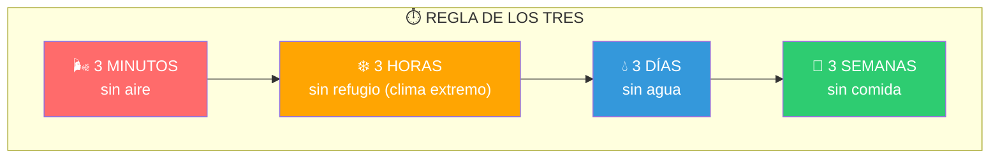
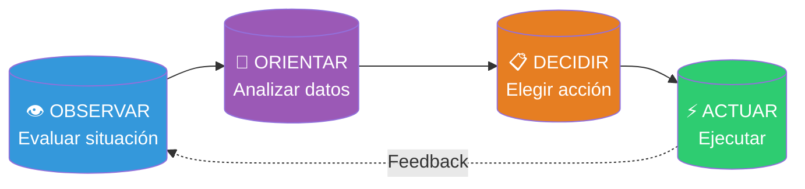
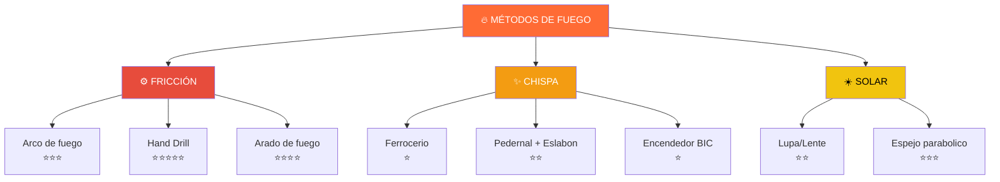
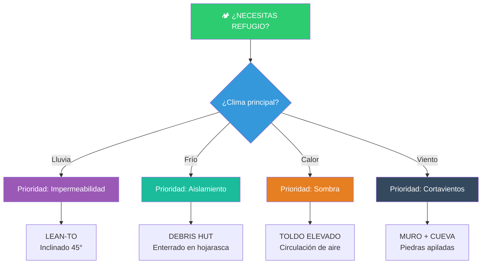
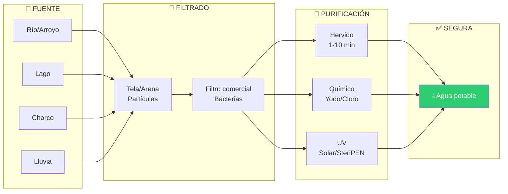
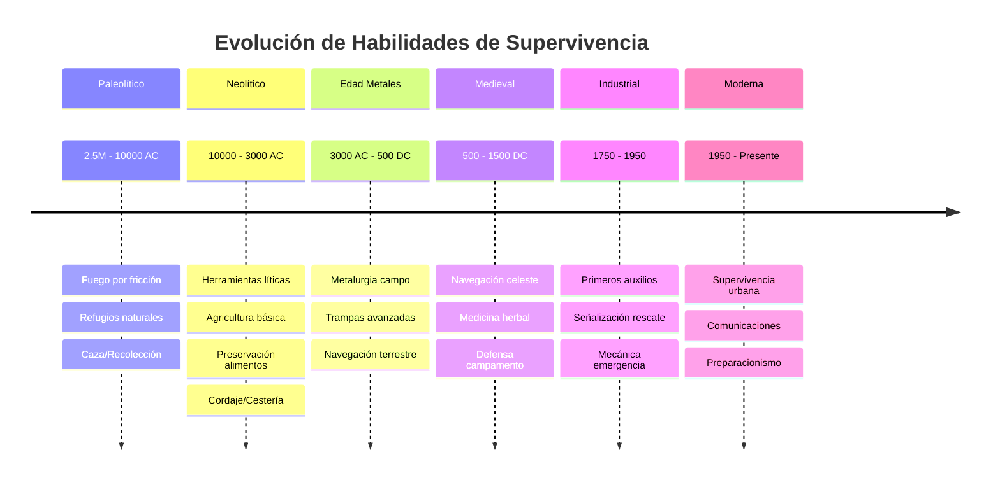
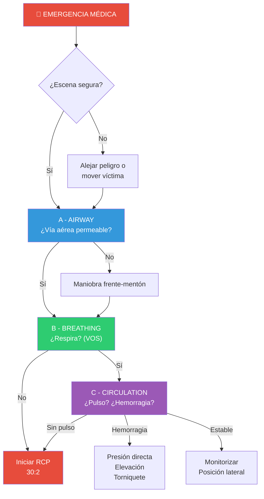
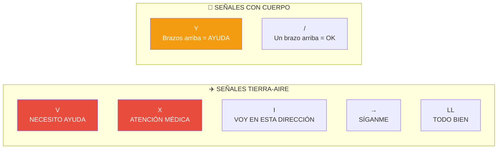
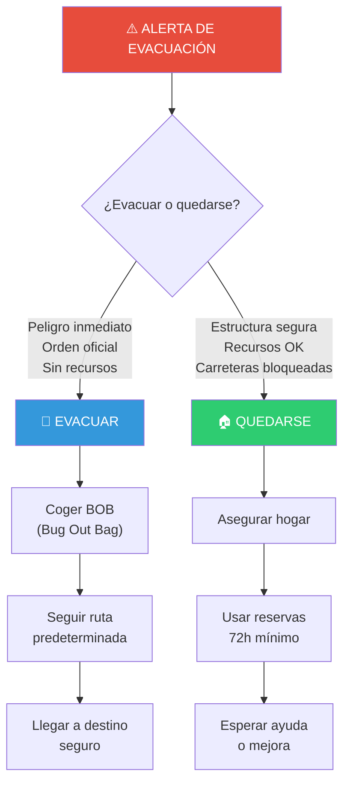
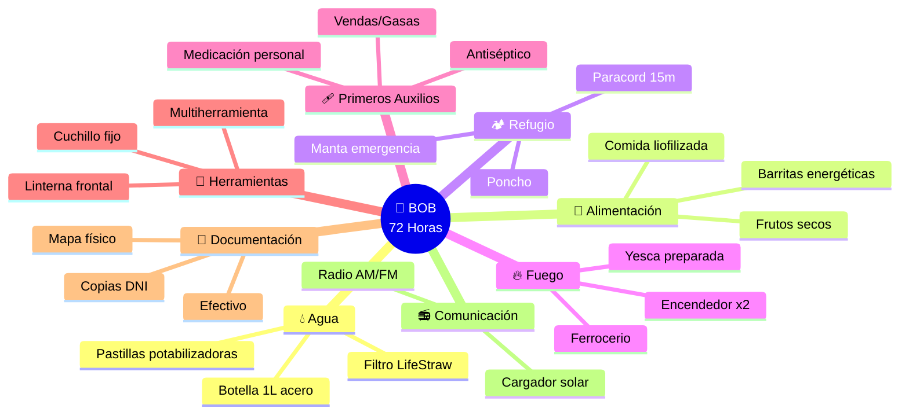

# Diagramas del Curso de Supervivencia

Este archivo contiene todos los diagramas Mermaid del curso para su uso en presentaciones y materiales complementarios.

---

## Diagrama 1: Regla de los Tres (Prioridades de Supervivencia)



---

## Diagrama 2: Ciclo OODA (Toma de Decisiones)



---

## Diagrama 3: Métodos de Encendido de Fuego



---

## Diagrama 4: Árbol de Decisión para Refugio



---

## Diagrama 5: Proceso de Purificación de Agua



---

## Diagrama 6: Evolución Histórica de Habilidades



---

## Diagrama 7: Protocolo ABC de Emergencias Médicas



---

## Diagrama 8: Señales Internacionales de Tierra-Aire



---

## Diagrama 9: Plan de Evacuación Urbana



---

## Diagrama 10: Contenido del Bug Out Bag (BOB)



---

## Prompts para Generación de Imágenes (DALL-E / Midjourney)

### Imagen 1: Portada del Curso
```
Survival course cover illustration, prehistoric to modern evolution theme, showing silhouettes of humans through ages (caveman with fire, medieval explorer with compass, modern prepper with backpack), warm earth tones gradient background, educational documentary style, cinematic lighting, 16:9 aspect ratio
```

### Imagen 2: Encendido de Fuego por Arco
```
Detailed instructional illustration of bow drill fire starting technique, hands demonstrating proper form, wooden spindle and fireboard, ember forming in notch, smoke rising, wilderness background, technical diagram style with clean lines, warm lighting, educational
```

### Imagen 3: Construcción de Refugio Debris Hut
```
Cross-section illustration of debris hut survival shelter construction, cutaway view showing internal structure with person inside, layers of leaves and branches visible, forest setting, technical educational style, labeled diagram aesthetic, natural colors
```

### Imagen 4: Navegación por Estrellas
```
Educational night sky illustration showing Big Dipper (Osa Mayor) pointing to Polaris (North Star), dotted lines connecting stars, constellation labels, dark blue starry background, vintage astronomy chart style, educational infographic
```

### Imagen 5: Kit de Supervivencia Desplegado
```
Flat lay photography style illustration of complete survival kit contents arranged neatly on dark background, knife, fire starter, water filter, first aid, paracord, compass, emergency blanket, organized grid layout, product photography lighting, detailed realistic style
```

### Imagen 6: Planta Comestible vs Venenosa
```
Side by side botanical comparison illustration, edible wild plant on left (clearly marked safe), poisonous look-alike on right (marked danger), detailed leaf and berry drawings, field guide style, educational labels pointing to key differences, clean white background
```

---

## Notas de Uso

1. Los diagramas Mermaid pueden renderizarse en:
   - GitHub/GitLab (nativamente)
   - Obsidian
   - VS Code con extensión Mermaid
   - mermaid.live (editor online)

2. Los prompts de imagen están optimizados para:
   - DALL-E 3
   - Midjourney v5+
   - Stable Diffusion XL

3. Para exportar diagramas a PNG/SVG, usar mermaid-cli o mermaid.live
