# ARQUITECTURA CURRICULAR: SUPERVIVENCIA - DE LA PREHISTORIA A LA ACTUALIDAD

## METADATA

- **Complejidad**: Intermedio-Avanzado
- **Duración estimada**: 40-50 horas
- **Audiencia objetivo**: Adultos interesados en autosuficiencia, preparacionismo y habilidades de supervivencia
- **Prerrequisitos obligatorios**:
  1. Capacidad física básica para actividades al aire libre
  2. Disposición para prácticas manuales
  3. Conocimiento básico de geografía y orientación
- **Fecha de diseño**: 2026-01-30

## FILOSOFÍA DEL CURSO

Este curso sigue un enfoque **cronológico-evolutivo**: cada módulo representa una era de la humanidad y las técnicas de supervivencia que desarrollamos en ella. Al recorrer este camino, el estudiante no solo aprende habilidades prácticas, sino que comprende **por qué** funcionan y cómo la humanidad las perfeccionó.

> "Para sobrevivir en el futuro, debemos dominar el pasado."

## MAPA CONCEPTUAL

```mermaid
graph TD
    subgraph "MÓDULO 0: Fundamentos"
        M0[Mentalidad y Evaluación]
    end

    subgraph "MÓDULO 1: Era Paleolítica"
        M1A[Fuego Primitivo]
        M1B[Refugio Natural]
        M1C[Agua y Purificación]
        M1D[Alimentación: Caza y Recolección]
    end

    subgraph "MÓDULO 2: Era Neolítica"
        M2A[Herramientas Líticas]
        M2B[Agricultura de Emergencia]
        M2C[Preservación de Alimentos]
        M2D[Cordaje y Cestería]
    end

    subgraph "MÓDULO 3: Era de los Metales"
        M3A[Metalurgia Básica]
        M3B[Trampas y Caza Avanzada]
        M3C[Navegación Terrestre]
    end

    subgraph "MÓDULO 4: Era Medieval"
        M4A[Orientación Celeste]
        M4B[Medicina Natural]
        M4C[Defensa y Seguridad]
    end

    subgraph "MÓDULO 5: Era Industrial"
        M5A[Primeros Auxilios Modernos]
        M5B[Señalización y Rescate]
        M5C[Mecánica de Emergencia]
    end

    subgraph "MÓDULO 6: Era Moderna"
        M6A[Supervivencia Urbana]
        M6B[Comunicaciones de Emergencia]
        M6C[Preparacionismo]
    end

    subgraph "MÓDULO 7: Proyecto Final"
        M7[Inmersión 72 Horas]
    end

    M0 --> M1A
    M1A --> M1B --> M1C --> M1D
    M1D --> M2A
    M2A --> M2B --> M2C --> M2D
    M2D --> M3A
    M3A --> M3B --> M3C
    M3C --> M4A
    M4A --> M4B --> M4C
    M4C --> M5A
    M5A --> M5B --> M5C
    M5C --> M6A
    M6A --> M6B --> M6C
    M6C --> M7
```



## OBJETIVOS GENERALES DEL CURSO

1. **Dominar las 5 prioridades de supervivencia** (refugio, agua, fuego, comida, señalización) utilizando técnicas de múltiples eras históricas
2. **Construir y utilizar herramientas** desde materiales naturales hasta equipamiento moderno de emergencia
3. **Evaluar y adaptarse** a diferentes escenarios de supervivencia (silvestre, urbano, desastre natural)
4. **Planificar y ejecutar** una estrategia de preparación personal y familiar completa
5. **Aplicar primeros auxilios** y medicina de emergencia en condiciones austeras

---

## ESTRUCTURA MODULAR

### MÓDULO 0: Diagnóstico y Mentalidad del Superviviente

**Duración**: 3 horas
**Objetivo**: Establecer la base psicológica y evaluar conocimientos previos del estudiante

#### TEMA 0.1: La Psicología de la Supervivencia

**Objetivo del Tema**: Comprender los factores mentales que determinan la supervivencia

- **Subtema 0.1.1**: La Regla de los Tres
  - Objetivo: Recordar las prioridades temporales de supervivencia (3 min sin aire, 3h sin refugio, 3 días sin agua, 3 semanas sin comida)
  - Tipo: Teoría
  - Requiere Práctica: No

- **Subtema 0.1.2**: El Ciclo OODA (Observar-Orientar-Decidir-Actuar)
  - Objetivo: Aplicar el modelo de toma de decisiones bajo estrés
  - Tipo: Teoría + Ejercicio mental
  - Requiere Práctica: Sí (simulación de escenarios)

- **Subtema 0.1.3**: Control del Pánico y Estrés Agudo
  - Objetivo: Implementar técnicas de respiración y anclaje para mantener la calma
  - Tipo: Práctica
  - Requiere Práctica: Sí

#### TEMA 0.2: Evaluación de Escenarios

**Objetivo del Tema**: Analizar situaciones de emergencia y priorizar acciones

- **Subtema 0.2.1**: SWOT de Supervivencia (Fortalezas, Debilidades, Oportunidades, Amenazas)
  - Objetivo: Evaluar recursos disponibles y riesgos inmediatos
  - Tipo: Mixto
  - Requiere Práctica: Sí

- **Subtema 0.2.2**: El Kit de los 10 Esenciales
  - Objetivo: Identificar y justificar el equipo mínimo de supervivencia
  - Tipo: Teoría
  - Requiere Práctica: No

---

### MÓDULO 1: Era Paleolítica - Habilidades Primitivas Fundamentales

**Duración**: 8 horas
**Objetivo**: Dominar las técnicas de supervivencia más antiguas que utilizó el Homo sapiens

#### TEMA 1.1: El Fuego Primordial

**Objetivo del Tema**: Crear fuego sin herramientas modernas

- **Subtema 1.1.1**: Teoría de la Combustión
  - Objetivo: Comprender el triángulo del fuego y tipos de combustibles naturales
  - Tipo: Teoría
  - Requiere Práctica: No

- **Subtema 1.1.2**: Fricción por Taladro de Arco (Bow Drill)
  - Objetivo: Construir y utilizar un taladro de arco para generar brasa
  - Tipo: Práctica intensiva
  - Requiere Práctica: Sí (2-3 horas)

- **Subtema 1.1.3**: Fricción Manual (Hand Drill)
  - Objetivo: Aplicar la técnica de fricción manual con maderas adecuadas
  - Tipo: Práctica
  - Requiere Práctica: Sí

- **Subtema 1.1.4**: Percusión con Pedernal
  - Objetivo: Generar chispas mediante percusión de sílex/pedernal con pirita o acero
  - Tipo: Práctica
  - Requiere Práctica: Sí

#### TEMA 1.2: Refugio Natural

**Objetivo del Tema**: Construir refugios usando solo materiales del entorno

- **Subtema 1.2.1**: Principios de Aislamiento Térmico
  - Objetivo: Comprender la pérdida de calor (conducción, convección, radiación, evaporación)
  - Tipo: Teoría
  - Requiere Práctica: No

- **Subtema 1.2.2**: Refugio de Escombros (Debris Hut)
  - Objetivo: Construir un refugio de escombros para una persona en menos de 2 horas
  - Tipo: Práctica
  - Requiere Práctica: Sí

- **Subtema 1.2.3**: Refugio de Rama Inclinada (Lean-To)
  - Objetivo: Edificar un lean-to con reflector de calor
  - Tipo: Práctica
  - Requiere Práctica: Sí

- **Subtema 1.2.4**: Refugios de Nieve (Quinzee y Cueva)
  - Objetivo: Construir refugios en ambiente invernal
  - Tipo: Teoría + Práctica (si hay condiciones)
  - Requiere Práctica: Condicional

#### TEMA 1.3: Obtención y Purificación de Agua

**Objetivo del Tema**: Localizar, recolectar y purificar agua en la naturaleza

- **Subtema 1.3.1**: Lectura del Terreno para Localizar Agua
  - Objetivo: Identificar indicadores naturales de fuentes de agua
  - Tipo: Teoría + Práctica de campo
  - Requiere Práctica: Sí

- **Subtema 1.3.2**: Recolección de Rocío y Condensación
  - Objetivo: Implementar técnicas de recolección pasiva de agua
  - Tipo: Práctica
  - Requiere Práctica: Sí

- **Subtema 1.3.3**: Destilador Solar
  - Objetivo: Construir y operar un destilador solar básico
  - Tipo: Práctica
  - Requiere Práctica: Sí

- **Subtema 1.3.4**: Hervido y Piedras Calientes
  - Objetivo: Purificar agua sin recipientes metálicos usando piedras calientes
  - Tipo: Práctica
  - Requiere Práctica: Sí

#### TEMA 1.4: Alimentación Paleolítica

**Objetivo del Tema**: Obtener alimento mediante caza primitiva y recolección

- **Subtema 1.4.1**: Plantas Comestibles Universales
  - Objetivo: Identificar 10 plantas comestibles de distribución amplia
  - Tipo: Teoría + Campo
  - Requiere Práctica: Sí

- **Subtema 1.4.2**: Test Universal de Comestibilidad
  - Objetivo: Aplicar el protocolo de prueba para plantas desconocidas
  - Tipo: Teoría
  - Requiere Práctica: No (solo conceptual)

- **Subtema 1.4.3**: Caza Menor con Herramientas Improvisadas
  - Objetivo: Construir y usar lanzas, garrotes y boleadoras
  - Tipo: Práctica
  - Requiere Práctica: Sí

- **Subtema 1.4.4**: Pesca Primitiva
  - Objetivo: Fabricar anzuelos de hueso/madera y trampas para peces
  - Tipo: Práctica
  - Requiere Práctica: Sí

---

### MÓDULO 2: Era Neolítica - Asentamiento y Tecnología Básica

**Duración**: 7 horas
**Objetivo**: Desarrollar habilidades de producción y almacenamiento que permitieron los primeros asentamientos

#### TEMA 2.1: Herramientas Líticas

**Objetivo del Tema**: Fabricar herramientas de piedra funcionales

- **Subtema 2.1.1**: Selección de Materiales (Obsidiana, Sílex, Cuarzo)
  - Objetivo: Identificar y evaluar rocas aptas para talla
  - Tipo: Teoría + Campo
  - Requiere Práctica: Sí

- **Subtema 2.1.2**: Talla por Percusión Directa
  - Objetivo: Producir lascas cortantes mediante percusión
  - Tipo: Práctica
  - Requiere Práctica: Sí

- **Subtema 2.1.3**: Fabricación de Cuchillo y Raspador
  - Objetivo: Crear herramientas de corte funcionales
  - Tipo: Práctica
  - Requiere Práctica: Sí

#### TEMA 2.2: Agricultura de Emergencia

**Objetivo del Tema**: Cultivar alimentos básicos en situaciones de supervivencia prolongada

- **Subtema 2.2.1**: Identificación de Suelos Fértiles
  - Objetivo: Evaluar terrenos para cultivo improvisado
  - Tipo: Teoría + Campo
  - Requiere Práctica: Sí

- **Subtema 2.2.2**: Cultivos de Ciclo Rápido
  - Objetivo: Conocer y plantar especies de rápido rendimiento (rábano, espinaca, legumbres)
  - Tipo: Mixto
  - Requiere Práctica: Sí (proyecto a largo plazo)

- **Subtema 2.2.3**: Recolección y Almacenamiento de Semillas
  - Objetivo: Preservar semillas viables para futuros cultivos
  - Tipo: Práctica
  - Requiere Práctica: Sí

#### TEMA 2.3: Preservación de Alimentos

**Objetivo del Tema**: Conservar alimentos sin refrigeración ni electricidad

- **Subtema 2.3.1**: Secado y Deshidratación
  - Objetivo: Secar carnes, frutas y vegetales usando sol y humo
  - Tipo: Práctica
  - Requiere Práctica: Sí

- **Subtema 2.3.2**: Ahumado en Frío y Caliente
  - Objetivo: Construir ahumador improvisado y procesar alimentos
  - Tipo: Práctica
  - Requiere Práctica: Sí

- **Subtema 2.3.3**: Salazón y Curado
  - Objetivo: Aplicar técnicas de preservación con sal
  - Tipo: Práctica
  - Requiere Práctica: Sí

- **Subtema 2.3.4**: Fermentación Básica
  - Objetivo: Fermentar vegetales para preservación (chucrut, kimchi primitivo)
  - Tipo: Práctica
  - Requiere Práctica: Sí

#### TEMA 2.4: Cordaje y Cestería

**Objetivo del Tema**: Fabricar cuerdas y contenedores con fibras naturales

- **Subtema 2.4.1**: Extracción de Fibras Vegetales
  - Objetivo: Procesar plantas para obtener fibras (ortiga, lino silvestre, corteza)
  - Tipo: Práctica
  - Requiere Práctica: Sí

- **Subtema 2.4.2**: Técnica de Torcido Inverso
  - Objetivo: Fabricar cordaje resistente mediante torcido
  - Tipo: Práctica
  - Requiere Práctica: Sí

- **Subtema 2.4.3**: Cestería de Enrollado
  - Objetivo: Construir cestas funcionales para almacenamiento y transporte
  - Tipo: Práctica
  - Requiere Práctica: Sí

---

### MÓDULO 3: Era de los Metales - Herramientas Avanzadas y Caza

**Duración**: 6 horas
**Objetivo**: Incorporar técnicas de la Edad del Bronce y Hierro para mayor eficiencia

#### TEMA 3.1: Metalurgia de Campo

**Objetivo del Tema**: Comprender y aplicar principios básicos de trabajo con metales

- **Subtema 3.1.1**: Identificación de Metales en la Naturaleza y Escombros
  - Objetivo: Reconocer fuentes de metal reciclable y mineral
  - Tipo: Teoría
  - Requiere Práctica: No

- **Subtema 3.1.2**: Forja Improvisada
  - Objetivo: Construir una forja básica con materiales disponibles
  - Tipo: Práctica
  - Requiere Práctica: Sí

- **Subtema 3.1.3**: Templado y Afilado de Herramientas
  - Objetivo: Mejorar y mantener herramientas metálicas
  - Tipo: Práctica
  - Requiere Práctica: Sí

#### TEMA 3.2: Trampas y Caza Sistemática

**Objetivo del Tema**: Diseñar y construir trampas para caza pasiva eficiente

- **Subtema 3.2.1**: Principios de Comportamiento Animal
  - Objetivo: Analizar patrones de movimiento y hábitos de presas
  - Tipo: Teoría
  - Requiere Práctica: No

- **Subtema 3.2.2**: Trampas de Lazo (Snares)
  - Objetivo: Construir y posicionar lazos efectivos
  - Tipo: Práctica
  - Requiere Práctica: Sí

- **Subtema 3.2.3**: Trampas de Caída (Deadfalls)
  - Objetivo: Fabricar trampas de aplastamiento seguras y efectivas
  - Tipo: Práctica
  - Requiere Práctica: Sí

- **Subtema 3.2.4**: Arco y Flechas Primitivos
  - Objetivo: Construir un arco funcional y flechas con puntas de piedra o metal
  - Tipo: Práctica intensiva
  - Requiere Práctica: Sí

#### TEMA 3.3: Navegación Terrestre

**Objetivo del Tema**: Orientarse y navegar sin instrumentos modernos

- **Subtema 3.3.1**: Orientación por el Sol
  - Objetivo: Determinar puntos cardinales usando métodos solares
  - Tipo: Práctica
  - Requiere Práctica: Sí

- **Subtema 3.3.2**: Navegación por Referencias Naturales
  - Objetivo: Usar vegetación, viento y terreno para orientación
  - Tipo: Mixto
  - Requiere Práctica: Sí

- **Subtema 3.3.3**: Mapeo Mental y Señalización de Rutas
  - Objetivo: Crear mapas mentales y marcar caminos de retorno
  - Tipo: Práctica
  - Requiere Práctica: Sí

---

### MÓDULO 4: Era Medieval - Conocimiento Acumulado

**Duración**: 6 horas
**Objetivo**: Aplicar el conocimiento sistematizado de la Edad Media para supervivencia

#### TEMA 4.1: Navegación Celeste

**Objetivo del Tema**: Orientarse usando estrellas, luna y constelaciones

- **Subtema 4.1.1**: La Estrella Polar y la Cruz del Sur
  - Objetivo: Localizar el norte/sur usando constelaciones clave
  - Tipo: Teoría + Práctica nocturna
  - Requiere Práctica: Sí

- **Subtema 4.1.2**: Navegación Lunar
  - Objetivo: Usar las fases lunares para determinar dirección
  - Tipo: Teoría
  - Requiere Práctica: No

- **Subtema 4.1.3**: Estimación de Tiempo por Cielo
  - Objetivo: Calcular hora aproximada usando posición celeste
  - Tipo: Práctica
  - Requiere Práctica: Sí

#### TEMA 4.2: Medicina Natural y Herbolaria

**Objetivo del Tema**: Tratar dolencias comunes con plantas medicinales

- **Subtema 4.2.1**: Botiquín Herbal (10 Plantas Esenciales)
  - Objetivo: Identificar y preparar plantas medicinales comunes
  - Tipo: Teoría + Campo
  - Requiere Práctica: Sí

- **Subtema 4.2.2**: Preparación de Tinturas, Cataplasmas e Infusiones
  - Objetivo: Elaborar medicamentos herbales básicos
  - Tipo: Práctica
  - Requiere Práctica: Sí

- **Subtema 4.2.3**: Tratamiento de Heridas con Recursos Naturales
  - Objetivo: Limpiar, desinfectar y cubrir heridas sin suministros modernos
  - Tipo: Práctica
  - Requiere Práctica: Sí

#### TEMA 4.3: Defensa y Seguridad del Campamento

**Objetivo del Tema**: Proteger recursos y personas en situaciones de supervivencia

- **Subtema 4.3.1**: Selección de Ubicación Defensiva
  - Objetivo: Evaluar terreno para establecer campamento seguro
  - Tipo: Teoría + Campo
  - Requiere Práctica: Sí

- **Subtema 4.3.2**: Sistemas de Alerta Perimetral
  - Objetivo: Construir alarmas y trampas de aviso
  - Tipo: Práctica
  - Requiere Práctica: Sí

- **Subtema 4.3.3**: Ocultamiento y Camuflaje
  - Objetivo: Disimular campamento y recursos de observadores
  - Tipo: Práctica
  - Requiere Práctica: Sí

---

### MÓDULO 5: Era Industrial - Técnicas Modernas de Emergencia

**Duración**: 6 horas
**Objetivo**: Integrar conocimientos de la era industrial para supervivencia estructurada

#### TEMA 5.1: Primeros Auxilios de Campo

**Objetivo del Tema**: Proporcionar atención médica de emergencia con recursos limitados

- **Subtema 5.1.1**: Evaluación Primaria (ABC: Airway, Breathing, Circulation)
  - Objetivo: Ejecutar protocolo de evaluación de víctima
  - Tipo: Práctica
  - Requiere Práctica: Sí

- **Subtema 5.1.2**: Control de Hemorragias
  - Objetivo: Aplicar presión directa, torniquetes improvisados y puntos de presión
  - Tipo: Práctica
  - Requiere Práctica: Sí

- **Subtema 5.1.3**: Inmovilización de Fracturas
  - Objetivo: Crear férulas con materiales disponibles
  - Tipo: Práctica
  - Requiere Práctica: Sí

- **Subtema 5.1.4**: Tratamiento de Hipotermia e Hipertermia
  - Objetivo: Reconocer y tratar emergencias térmicas
  - Tipo: Mixto
  - Requiere Práctica: Sí

#### TEMA 5.2: Señalización y Rescate

**Objetivo del Tema**: Maximizar probabilidades de ser encontrado por equipos de rescate

- **Subtema 5.2.1**: Señales Visuales (Fuego, Espejos, Patrones)
  - Objetivo: Crear señales visibles desde aire y tierra
  - Tipo: Práctica
  - Requiere Práctica: Sí

- **Subtema 5.2.2**: Señales Auditivas (Silbato, Código Morse)
  - Objetivo: Usar sonido para comunicar posición y emergencia
  - Tipo: Práctica
  - Requiere Práctica: Sí

- **Subtema 5.2.3**: Zona de Aterrizaje y Extracción
  - Objetivo: Preparar área para rescate aéreo
  - Tipo: Teoría + Práctica
  - Requiere Práctica: Sí

#### TEMA 5.3: Mecánica de Emergencia

**Objetivo del Tema**: Reparar y adaptar equipos mecánicos básicos

- **Subtema 5.3.1**: Reparación de Vehículos (Básico)
  - Objetivo: Solucionar problemas comunes de arranque y movilidad
  - Tipo: Teoría + Práctica
  - Requiere Práctica: Sí

- **Subtema 5.3.2**: Generación de Energía Improvisada
  - Objetivo: Crear fuentes de electricidad básica (dinamo, solar improvisado)
  - Tipo: Práctica
  - Requiere Práctica: Sí

- **Subtema 5.3.3**: Purificación de Combustible
  - Objetivo: Filtrar y mejorar combustibles degradados
  - Tipo: Teoría
  - Requiere Práctica: No

---

### MÓDULO 6: Era Moderna - Supervivencia en el Siglo XXI

**Duración**: 6 horas
**Objetivo**: Aplicar técnicas contemporáneas de preparación y supervivencia urbana

#### TEMA 6.1: Supervivencia Urbana

**Objetivo del Tema**: Sobrevivir en entornos urbanos durante emergencias y colapsos

- **Subtema 6.1.1**: Evaluación de Riesgos Urbanos
  - Objetivo: Identificar amenazas específicas de entornos urbanos
  - Tipo: Teoría
  - Requiere Práctica: No

- **Subtema 6.1.2**: Recursos Ocultos en la Ciudad
  - Objetivo: Localizar agua, alimento y refugio en entornos urbanos
  - Tipo: Mixto
  - Requiere Práctica: Sí

- **Subtema 6.1.3**: Evacuación Urbana (Bug Out)
  - Objetivo: Planificar y ejecutar rutas de evacuación
  - Tipo: Práctica
  - Requiere Práctica: Sí

- **Subtema 6.1.4**: Defensa Civil y Refugios Antiaéreos
  - Objetivo: Identificar y utilizar infraestructura de protección civil
  - Tipo: Teoría
  - Requiere Práctica: No

#### TEMA 6.2: Comunicaciones de Emergencia

**Objetivo del Tema**: Mantener comunicación cuando fallan los sistemas convencionales

- **Subtema 6.2.1**: Radio de Banda Ciudadana y PMR
  - Objetivo: Operar equipos de radio de corto alcance
  - Tipo: Práctica
  - Requiere Práctica: Sí

- **Subtema 6.2.2**: Radioafición Básica de Emergencia
  - Objetivo: Comprender principios de comunicación HF/VHF para emergencias
  - Tipo: Teoría
  - Requiere Práctica: No

- **Subtema 6.2.3**: Redes Mesh y Comunicación Digital Descentralizada
  - Objetivo: Conocer sistemas de comunicación P2P sin infraestructura
  - Tipo: Teoría
  - Requiere Práctica: No

#### TEMA 6.3: Preparacionismo Integral

**Objetivo del Tema**: Diseñar un sistema completo de preparación personal y familiar

- **Subtema 6.3.1**: Kit de 72 Horas (Bug Out Bag)
  - Objetivo: Ensamblar y personalizar un kit de supervivencia portátil
  - Tipo: Práctica
  - Requiere Práctica: Sí

- **Subtema 6.3.2**: Almacenamiento de Largo Plazo
  - Objetivo: Planificar reservas de agua, alimentos y suministros
  - Tipo: Mixto
  - Requiere Práctica: Sí

- **Subtema 6.3.3**: Plan Familiar de Emergencia
  - Objetivo: Crear protocolos de comunicación y reunión familiar
  - Tipo: Práctica
  - Requiere Práctica: Sí

- **Subtema 6.3.4**: Resiliencia Financiera y Documental
  - Objetivo: Proteger documentos importantes y recursos financieros
  - Tipo: Teoría
  - Requiere Práctica: No

---

### MÓDULO 7: Proyecto Integrador - Inmersión de 72 Horas

**Duración**: 8+ horas (planificación) + 72 horas (ejecución opcional)
**Objetivo**: Sintetizar todos los conocimientos en una experiencia práctica integral

### Especificaciones del Proyecto

- **Alcance**: Planificación y ejecución (simulada o real) de supervivencia autónoma durante 72 horas
- **Entregables**:
  1. Plan de supervivencia detallado (escenario elegido)
  2. Inventario de recursos y kit personalizado
  3. Diario de campo (real o simulado)
  4. Análisis post-acción con lecciones aprendidas
- **Criterios de evaluación**:
  - Aplicación de técnicas de múltiples eras
  - Solución de problemas imprevistos
  - Gestión de recursos
  - Documentación y reflexión

### Diferenciación por Nivel

**Básico**:
- Escenario controlado (camping en área conocida)
- Kit completo permitido
- Comunicación de emergencia disponible
- Duración: 24-48 horas

**Intermedio**:
- Escenario semi-silvestre
- Kit mínimo (10 items)
- Comunicación limitada (check-in cada 12h)
- Duración: 48-72 horas

**Avanzado**:
- Escenario silvestre desconocido
- Sin kit preparado (solo ropa y cuchillo)
- Solo comunicación de emergencia real
- Duración: 72+ horas

---

## RECURSOS TÉCNICOS REQUERIDOS

### Para el Estudiante

- **Herramientas básicas**: Cuchillo de supervivencia, pedernal, paracord (15m), lona impermeable
- **Materiales de práctica**: Maderas variadas (sauce, cedro), fibras naturales, recipientes metálicos
- **Equipo de campo**: Mochila 40-60L, botella de acero, brújula, botiquín básico
- **Documentación**: Cuaderno de campo resistente al agua

### Para el Instructor/Plataforma

- **Área de práctica**: Terreno natural accesible con madera, agua y diversidad vegetal
- **Materiales de demostración**: Sets de talla lítica, plantas medicinales preservadas
- **Equipo de seguridad**: Botiquín avanzado, comunicaciones, transporte de emergencia

---

## PLAN DE ACTUALIZACIÓN

- **Vigencia estimada**: 5 años (las técnicas tradicionales son atemporales)
- **Puntos de actualización**:
  - Módulo 6 (tecnología de comunicaciones evoluciona rápidamente)
  - Legislación sobre trampas y caza según jurisdicción
- **Estrategia de mantenimiento**: Revisión anual del módulo de preparacionismo

---

## MATRIZ DE TRAZABILIDAD

| Módulo | Conceptos | Objetivos Bloom | Evaluaciones | Tiempo (h) |
|--------|-----------|-----------------|--------------|------------|
| 0 | 5 | Recordar/Comprender | Diagnóstica | 3 |
| 1 | 16 | Comprender/Aplicar | Formativa + Práctica | 8 |
| 2 | 13 | Aplicar/Analizar | Formativa + Práctica | 7 |
| 3 | 10 | Aplicar/Analizar | Formativa + Práctica | 6 |
| 4 | 9 | Aplicar/Evaluar | Formativa + Práctica | 6 |
| 5 | 10 | Aplicar/Analizar | Formativa + Práctica | 6 |
| 6 | 12 | Analizar/Crear | Formativa | 6 |
| 7 | Integrado | Crear/Evaluar | Sumativa | 8+ |
| **TOTAL** | **75** | **Todos los niveles** | **8** | **50+** |

---

## ALERTAS Y CONSIDERACIONES

### Cuellos de Botella Identificados

1. **Técnicas de fuego por fricción** (Módulo 1): Alta tasa de frustración inicial
2. **Talla lítica** (Módulo 2): Riesgo de cortes, requiere supervisión
3. **Trampas** (Módulo 3): Consideraciones legales y éticas variables
4. **Proyecto final** (Módulo 7): Logística compleja, dependencia climática

### Estrategias de Mitigación

1. Fuego: Incluir técnicas de respaldo (lupa, batería) para mantener motivación
2. Talla: Equipo de protección obligatorio, práctica gradual
3. Trampas: Enfoque en diseño y construcción sin activación real
4. Proyecto: Opciones de simulación urbana como alternativa

### Flexibilidad del Plan

- Módulos 1-2 son **obligatorios y secuenciales**
- Módulos 3-5 pueden **reordenarse** según estación del año
- Módulo 6 puede **adelantarse** para audiencias principalmente urbanas
- El proyecto final puede **escalonarse** en múltiples salidas cortas

---

## ÁRBOL CURRICULAR (JSON)

```json
[
  {
    "modulo_id": 0,
    "titulo": "Diagnóstico y Mentalidad del Superviviente",
    "temas": [
      {
        "tema_id": "0.1",
        "titulo": "La Psicología de la Supervivencia",
        "subtemas": [
          {"subtema_id": "0.1.1", "titulo": "La Regla de los Tres"},
          {"subtema_id": "0.1.2", "titulo": "El Ciclo OODA"},
          {"subtema_id": "0.1.3", "titulo": "Control del Pánico y Estrés Agudo"}
        ]
      },
      {
        "tema_id": "0.2",
        "titulo": "Evaluación de Escenarios",
        "subtemas": [
          {"subtema_id": "0.2.1", "titulo": "SWOT de Supervivencia"},
          {"subtema_id": "0.2.2", "titulo": "El Kit de los 10 Esenciales"}
        ]
      }
    ]
  },
  {
    "modulo_id": 1,
    "titulo": "Era Paleolítica - Habilidades Primitivas Fundamentales",
    "temas": [
      {
        "tema_id": "1.1",
        "titulo": "El Fuego Primordial",
        "subtemas": [
          {"subtema_id": "1.1.1", "titulo": "Teoría de la Combustión"},
          {"subtema_id": "1.1.2", "titulo": "Fricción por Taladro de Arco"},
          {"subtema_id": "1.1.3", "titulo": "Fricción Manual"},
          {"subtema_id": "1.1.4", "titulo": "Percusión con Pedernal"}
        ]
      },
      {
        "tema_id": "1.2",
        "titulo": "Refugio Natural",
        "subtemas": [
          {"subtema_id": "1.2.1", "titulo": "Principios de Aislamiento Térmico"},
          {"subtema_id": "1.2.2", "titulo": "Refugio de Escombros"},
          {"subtema_id": "1.2.3", "titulo": "Refugio de Rama Inclinada"},
          {"subtema_id": "1.2.4", "titulo": "Refugios de Nieve"}
        ]
      },
      {
        "tema_id": "1.3",
        "titulo": "Obtención y Purificación de Agua",
        "subtemas": [
          {"subtema_id": "1.3.1", "titulo": "Lectura del Terreno para Localizar Agua"},
          {"subtema_id": "1.3.2", "titulo": "Recolección de Rocío y Condensación"},
          {"subtema_id": "1.3.3", "titulo": "Destilador Solar"},
          {"subtema_id": "1.3.4", "titulo": "Hervido y Piedras Calientes"}
        ]
      },
      {
        "tema_id": "1.4",
        "titulo": "Alimentación Paleolítica",
        "subtemas": [
          {"subtema_id": "1.4.1", "titulo": "Plantas Comestibles Universales"},
          {"subtema_id": "1.4.2", "titulo": "Test Universal de Comestibilidad"},
          {"subtema_id": "1.4.3", "titulo": "Caza Menor con Herramientas Improvisadas"},
          {"subtema_id": "1.4.4", "titulo": "Pesca Primitiva"}
        ]
      }
    ]
  },
  {
    "modulo_id": 2,
    "titulo": "Era Neolítica - Asentamiento y Tecnología Básica",
    "temas": [
      {
        "tema_id": "2.1",
        "titulo": "Herramientas Líticas",
        "subtemas": [
          {"subtema_id": "2.1.1", "titulo": "Selección de Materiales"},
          {"subtema_id": "2.1.2", "titulo": "Talla por Percusión Directa"},
          {"subtema_id": "2.1.3", "titulo": "Fabricación de Cuchillo y Raspador"}
        ]
      },
      {
        "tema_id": "2.2",
        "titulo": "Agricultura de Emergencia",
        "subtemas": [
          {"subtema_id": "2.2.1", "titulo": "Identificación de Suelos Fértiles"},
          {"subtema_id": "2.2.2", "titulo": "Cultivos de Ciclo Rápido"},
          {"subtema_id": "2.2.3", "titulo": "Recolección y Almacenamiento de Semillas"}
        ]
      },
      {
        "tema_id": "2.3",
        "titulo": "Preservación de Alimentos",
        "subtemas": [
          {"subtema_id": "2.3.1", "titulo": "Secado y Deshidratación"},
          {"subtema_id": "2.3.2", "titulo": "Ahumado en Frío y Caliente"},
          {"subtema_id": "2.3.3", "titulo": "Salazón y Curado"},
          {"subtema_id": "2.3.4", "titulo": "Fermentación Básica"}
        ]
      },
      {
        "tema_id": "2.4",
        "titulo": "Cordaje y Cestería",
        "subtemas": [
          {"subtema_id": "2.4.1", "titulo": "Extracción de Fibras Vegetales"},
          {"subtema_id": "2.4.2", "titulo": "Técnica de Torcido Inverso"},
          {"subtema_id": "2.4.3", "titulo": "Cestería de Enrollado"}
        ]
      }
    ]
  },
  {
    "modulo_id": 3,
    "titulo": "Era de los Metales - Herramientas Avanzadas y Caza",
    "temas": [
      {
        "tema_id": "3.1",
        "titulo": "Metalurgia de Campo",
        "subtemas": [
          {"subtema_id": "3.1.1", "titulo": "Identificación de Metales"},
          {"subtema_id": "3.1.2", "titulo": "Forja Improvisada"},
          {"subtema_id": "3.1.3", "titulo": "Templado y Afilado de Herramientas"}
        ]
      },
      {
        "tema_id": "3.2",
        "titulo": "Trampas y Caza Sistemática",
        "subtemas": [
          {"subtema_id": "3.2.1", "titulo": "Principios de Comportamiento Animal"},
          {"subtema_id": "3.2.2", "titulo": "Trampas de Lazo"},
          {"subtema_id": "3.2.3", "titulo": "Trampas de Caída"},
          {"subtema_id": "3.2.4", "titulo": "Arco y Flechas Primitivos"}
        ]
      },
      {
        "tema_id": "3.3",
        "titulo": "Navegación Terrestre",
        "subtemas": [
          {"subtema_id": "3.3.1", "titulo": "Orientación por el Sol"},
          {"subtema_id": "3.3.2", "titulo": "Navegación por Referencias Naturales"},
          {"subtema_id": "3.3.3", "titulo": "Mapeo Mental y Señalización de Rutas"}
        ]
      }
    ]
  },
  {
    "modulo_id": 4,
    "titulo": "Era Medieval - Conocimiento Acumulado",
    "temas": [
      {
        "tema_id": "4.1",
        "titulo": "Navegación Celeste",
        "subtemas": [
          {"subtema_id": "4.1.1", "titulo": "La Estrella Polar y la Cruz del Sur"},
          {"subtema_id": "4.1.2", "titulo": "Navegación Lunar"},
          {"subtema_id": "4.1.3", "titulo": "Estimación de Tiempo por Cielo"}
        ]
      },
      {
        "tema_id": "4.2",
        "titulo": "Medicina Natural y Herbolaria",
        "subtemas": [
          {"subtema_id": "4.2.1", "titulo": "Botiquín Herbal"},
          {"subtema_id": "4.2.2", "titulo": "Preparación de Medicamentos Herbales"},
          {"subtema_id": "4.2.3", "titulo": "Tratamiento de Heridas con Recursos Naturales"}
        ]
      },
      {
        "tema_id": "4.3",
        "titulo": "Defensa y Seguridad del Campamento",
        "subtemas": [
          {"subtema_id": "4.3.1", "titulo": "Selección de Ubicación Defensiva"},
          {"subtema_id": "4.3.2", "titulo": "Sistemas de Alerta Perimetral"},
          {"subtema_id": "4.3.3", "titulo": "Ocultamiento y Camuflaje"}
        ]
      }
    ]
  },
  {
    "modulo_id": 5,
    "titulo": "Era Industrial - Técnicas Modernas de Emergencia",
    "temas": [
      {
        "tema_id": "5.1",
        "titulo": "Primeros Auxilios de Campo",
        "subtemas": [
          {"subtema_id": "5.1.1", "titulo": "Evaluación Primaria ABC"},
          {"subtema_id": "5.1.2", "titulo": "Control de Hemorragias"},
          {"subtema_id": "5.1.3", "titulo": "Inmovilización de Fracturas"},
          {"subtema_id": "5.1.4", "titulo": "Tratamiento de Emergencias Térmicas"}
        ]
      },
      {
        "tema_id": "5.2",
        "titulo": "Señalización y Rescate",
        "subtemas": [
          {"subtema_id": "5.2.1", "titulo": "Señales Visuales"},
          {"subtema_id": "5.2.2", "titulo": "Señales Auditivas"},
          {"subtema_id": "5.2.3", "titulo": "Zona de Aterrizaje y Extracción"}
        ]
      },
      {
        "tema_id": "5.3",
        "titulo": "Mecánica de Emergencia",
        "subtemas": [
          {"subtema_id": "5.3.1", "titulo": "Reparación Básica de Vehículos"},
          {"subtema_id": "5.3.2", "titulo": "Generación de Energía Improvisada"},
          {"subtema_id": "5.3.3", "titulo": "Purificación de Combustible"}
        ]
      }
    ]
  },
  {
    "modulo_id": 6,
    "titulo": "Era Moderna - Supervivencia en el Siglo XXI",
    "temas": [
      {
        "tema_id": "6.1",
        "titulo": "Supervivencia Urbana",
        "subtemas": [
          {"subtema_id": "6.1.1", "titulo": "Evaluación de Riesgos Urbanos"},
          {"subtema_id": "6.1.2", "titulo": "Recursos Ocultos en la Ciudad"},
          {"subtema_id": "6.1.3", "titulo": "Evacuación Urbana"},
          {"subtema_id": "6.1.4", "titulo": "Defensa Civil y Refugios"}
        ]
      },
      {
        "tema_id": "6.2",
        "titulo": "Comunicaciones de Emergencia",
        "subtemas": [
          {"subtema_id": "6.2.1", "titulo": "Radio de Banda Ciudadana y PMR"},
          {"subtema_id": "6.2.2", "titulo": "Radioafición Básica"},
          {"subtema_id": "6.2.3", "titulo": "Redes Mesh Descentralizadas"}
        ]
      },
      {
        "tema_id": "6.3",
        "titulo": "Preparacionismo Integral",
        "subtemas": [
          {"subtema_id": "6.3.1", "titulo": "Kit de 72 Horas"},
          {"subtema_id": "6.3.2", "titulo": "Almacenamiento de Largo Plazo"},
          {"subtema_id": "6.3.3", "titulo": "Plan Familiar de Emergencia"},
          {"subtema_id": "6.3.4", "titulo": "Resiliencia Financiera y Documental"}
        ]
      }
    ]
  },
  {
    "modulo_id": 7,
    "titulo": "Proyecto Integrador - Inmersión de 72 Horas",
    "temas": [
      {
        "tema_id": "7.1",
        "titulo": "Planificación del Proyecto",
        "subtemas": [
          {"subtema_id": "7.1.1", "titulo": "Selección de Escenario"},
          {"subtema_id": "7.1.2", "titulo": "Diseño del Plan de Supervivencia"},
          {"subtema_id": "7.1.3", "titulo": "Preparación del Kit"}
        ]
      },
      {
        "tema_id": "7.2",
        "titulo": "Ejecución y Documentación",
        "subtemas": [
          {"subtema_id": "7.2.1", "titulo": "Diario de Campo"},
          {"subtema_id": "7.2.2", "titulo": "Registro Fotográfico"},
          {"subtema_id": "7.2.3", "titulo": "Análisis Post-Acción"}
        ]
      }
    ]
  }
]
```
